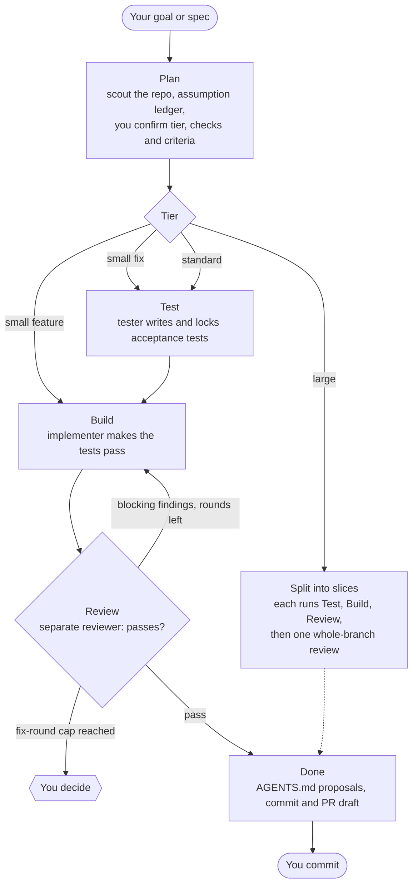

# loopwright

Make your AI coding agent plan, test, build and review like a careful team: a **Plan → Test → Build → Review → Done** workflow (Test is skipped for small feature tasks, and Review loops back to Build until it passes), installed into your repo as skills, subagents and hooks.

## Why

Left alone, coding agents:

- bake silent assumptions into the plan,
- write tests that fit their own code,
- grade their own work,
- forget agreed decisions after context compaction.

loopwright counters each of these:

- **Assumption ledger**: every assumption is stated; high-impact ones are asked one at a time.
- **Isolated contexts**: the tester never sees the implementation; the reviewer starts blind.
- **Enforced gates**: hooks block edits to locked tests and block finishing without a passing review.
- **No document sprawl**: one short task file per task, kept locally. Durable lessons go to your `AGENTS.md` only with your approval.

## Quick start

You need Node >= 22.14 and a git repository.

```bash
cd your-repo
npx loopwright init
```

Then open Claude Code in the repo and run:

```text
/loopwright-flow  add rate limiting to the login endpoint
```

The agent scouts your repo, asks you about its high-impact assumptions, and then walks the task through Test, Build, Review and Done, stopping wherever you need to decide. Nothing is committed for you.

`init` writes skills, subagents, hooks and a local `.loopwright/` folder. Commit the result to share it with your team, or use `npx loopwright init --global` to install into your home directory instead. See [Installation](docs/installation.md) for flags and the exact files written.

## How it works

The stages run in order, but the path depends on the task's size (its *tier*) and a failed review loops back to Build.



- **Plan** runs in your session. A read-only scout maps the repo, then you answer the high-impact questions one at a time and confirm the plan. Nothing is built before that.
- **Test** (standard, large, and every fix): a tester subagent, which never sees the implementation, writes acceptance tests from your confirmed criteria and locks them.
- **Build**: an implementer subagent makes the locked tests pass. Small feature tasks skip Test, so the implementer writes the tests; a fix never skips it.
- **Review**: a reviewer that starts blind runs your checks, confirms the locked tests are untouched, and reports only proven, high-impact findings. Blocking findings send the task back to Build, up to 3 rounds by default; findings it cannot confirm come to you to fix or dismiss.
- **Done**: proposes `AGENTS.md` updates and drafts the commit and PR message. You approve each change; loopwright never commits.

Each task's goal, decisions, criteria and review log live in `.loopwright/tasks/<date>-<title>.md`. For the large-tier slice loop, step-by-step Plan and Review charts, and every point where loopwright waits for you, see [Workflow in detail](docs/workflow.md).

### Commands

Run a single stage, or the whole loop with `flow`. In Codex, use `$` instead of `/`.

| Command | Does |
|---|---|
| `/loopwright-flow` | Run or resume the whole loop, stopping wherever you must decide |
| `/loopwright-fix` | Fix a bug: a repro test is locked first, then the root cause is fixed |
| `/loopwright-plan` | Plan stage |
| `/loopwright-test` | Test stage |
| `/loopwright-build` | Build stage |
| `/loopwright-review` | Review stage |
| `/loopwright-done` | Done stage |

## Support

| Feature | Claude Code | Codex | Junie CLI |
|---|---|---|---|
| Skills install | Supported, tested | WIP: installed, not tested end-to-end | WIP: reads `.agents/skills` |
| Subagents (scout, tester, implementer, reviewer) | Supported, tested | WIP: installed, not tested end-to-end | WIP: `.junie/agents` |
| Hook enforcement (locked-test guard, stop gate, context reinjection) | Supported, tested | WIP: installed, not tested end-to-end | Experimental (`--experimental junie-hooks`, Early Access) |
| Structured questions | `AskUserQuestion` | Plain-text fallback (numbered options) | Plain-text fallback |
| Cross-agent review (as the reviewer) | Supported, tested | WIP: untested | Not supported |
| Global install | Supported, tested | WIP: installed, not tested end-to-end | WIP: `~/.junie/agents` |

Codex and Junie CLI support is work in progress.

- **Codex**: behavior was derived from Codex source and CLI help; no real Codex session has been run against loopwright yet. Expect rough edges.
- **Junie CLI**: its hooks are Early Access. Subagents are installed with per-role models from `models.junie` (default: scout `opus`, tester and implementer `sonnet`, reviewer `gpt`, so the review comes from a different vendor than the code). If your Junie plan cannot use a model, the stage skills retry the subagent without a model (Junie's default).

## Learn more

- [Installation](docs/installation.md): flags, files written, update, uninstall, worktrees.
- [Configuration](docs/configuration.md): models, fix rounds, cross-agent review, effort profiles (`lean`, `balanced`, `thorough`, `deep`; set with `--profile`), experimental features.
- [Workflow in detail](docs/workflow.md): the full flow with charts: slices, the Plan and Review steps, and where it waits for you.
- [Enforcement and its limits](docs/enforcement.md): what the hooks block, and what they cannot.
- [Dogfood checklist](docs/dogfood-checklist.md): a manual end-to-end test run.

## Contributing

See [CLAUDE.md](CLAUDE.md) for the project layout and conventions, [writing documentation guidelines](docs/writing-documentation-guidelines.md) before editing docs, and [Releasing](docs/releasing.md) for maintainers.

## License

MIT
