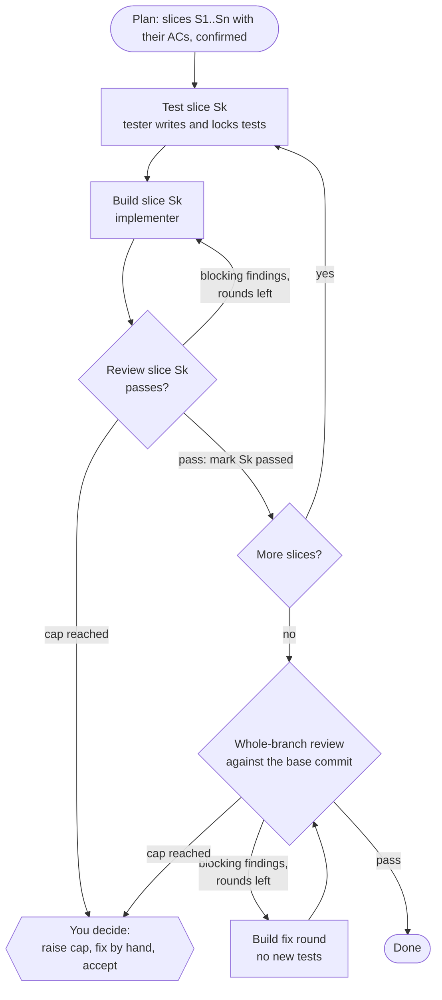
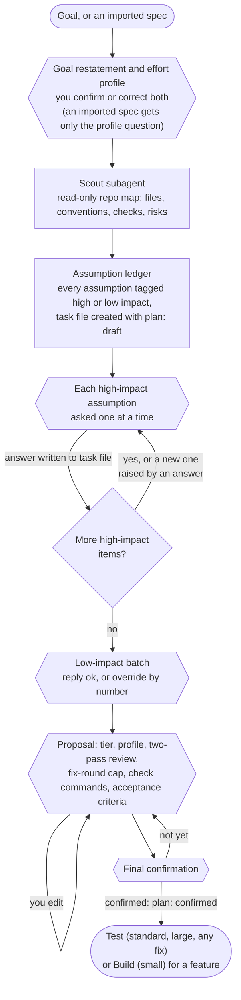
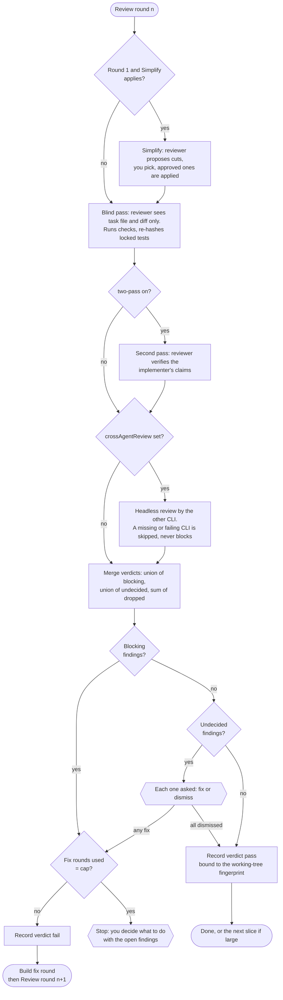

# Workflow in detail

The full flow behind `/loopwright-flow`. The [README](../README.md#how-it-works) has the short version. Each stage's `SKILL.md` in `content/skills/` is the authority; this page describes it.

Legend: rounded boxes are steps, diamonds are decisions, hexagons are points where loopwright stops and waits for you. "Main thread" means your session; subagents run in their own isolated context.

## Large tier: slices

Plan splits a large task into ordered slices. Each slice runs Test, Build and Review. When the last slice passes, one review covers the whole branch.



## Fixing a bug

`/loopwright-fix` runs the same stages with `kind: fix` in the task file. The differences:

- **Plan**: your goal is restated and you confirm it along with the effort profile, then the scout reads your bug report, log or issue. You are asked once for missing evidence (error text, steps, expected behavior) and confirm a root-cause hypothesis.
- **Test never skips**, at any tier. The tester writes a `[repro]` test for the correct behavior and locks it only after it fails for the reported reason, not for an unrelated one. A `[regression]` test covers behavior that must keep working and passes already.
- **No repro stops the task.** If the tester cannot reproduce the bug, you choose: add evidence, say which unit is at fault (a new `[repro]` criterion is recorded), or stop. There is no option to continue without a locked repro test; stopping marks the task `stopped`.
- **Build** names the root cause first and fixes it; suppressing the symptom (catching the error, special-casing the input) is not a fix.
- **Review** checks that the fix addresses the root cause and lists sibling code with the same flaw. After a pass you decide whether to include the siblings. Yes goes back to Plan and Test for their repro tests; no records them under `## Follow-ups` in the task file.
- **Done** puts the root cause, the repro test failing before and passing after, and the follow-ups in the PR draft.

## Parking work you find along the way

`/loopwright-park` captures work you notice while doing one task so the task does not grow. It restates the finding for you to edit, asks whether it blocks the current task (the recommendation is no), and writes a stub in `tasks/` with `status: proposed`. The current task's scope, tests and diff do not change; the stub is listed under its `## Follow-ups`. A blocking stub is best run first in a new worktree (see [Running tasks in parallel worktrees](#running-tasks-in-parallel-worktrees)).

Later, `/loopwright-flow` or `/loopwright-plan` without a goal lists the proposed stubs: start one (it goes through normal Plan in a fresh context), drop it, or begin a new task. Done lists the stubs found during a task, drafts issue text for each (shown, never filed) and adds a Follow-ups section to the PR draft.

## Running tasks in parallel worktrees

One task runs per git worktree, each in its own session, so a new goal does not wait on an unrelated task. Each worktree holds its own tasks in `.loopwright/` (see [Installation](installation.md#worktrees)).

When you give `/loopwright-flow`, `/loopwright-plan` or `/loopwright-fix` a new goal, the skill runs `lw.mjs tasks`, a read-only listing of the open tasks and parked stubs in every worktree:

- A task that looks related to the goal: you are asked whether to continue it. If it is in another worktree, nothing starts here; you get the command to continue it there. Which tasks are related is the agent's judgment, and it asks when unsure.
- Only unrelated tasks, and this worktree has no task: the goal starts here.
- This worktree is occupied (it has a task, Plan stage included): the skill says what occupies it and suggests a new worktree. It never offers to close or shelve an unrelated task. On yes it runs `lw.mjs worktree "<title>"`, which creates the sibling folder `../<repo-folder>-<slug>` on a new branch `<slug>` from `origin/HEAD` (else `main` or `master`, else `HEAD`; `--base <ref>` overrides), writes a `status: proposed` stub with your goal there, and prints the command to start a session in it:

```bash
cd ../my-repo-add-export && claude "/loopwright-flow"      # Claude Code
cd ../my-repo-add-export && codex '$loopwright-flow'       # Codex
cd ../my-repo-add-export                                   # Junie: start Junie, then run /loopwright-flow
```

`/loopwright-fix` adds `--kind fix`, so the stub keeps `kind: fix` and the new session still locks a repro test first (the default is `feature`). The new session lists the stub and plans from it in a fresh context. If the new worktree lacks the repo-mode install, the skill says so and prints `npx loopwright update` first. A stub from any worktree can start in a new worktree with `lw.mjs worktree "<title>" --stub <file>`; the original is marked `status: moved` and never deleted. Codex may ask for one sandbox approval to create the worktree (unverified; Codex support is WIP).

When Done closes a task in a linked worktree, it offers `lw.mjs carry`, which copies the worktree's proposed stubs to the main checkout's `tasks/` and marks the sources `status: moved`, so they outlive the worktree.

## Understanding an unfamiliar codebase

`/loopwright-explore [folder]` writes a walkthrough of a codebase, or of one folder of it, for someone new to it. It changes no code and runs no commands from the repository. Nothing outside `.loopwright/` is written unless you ask to copy the walkthrough in.

1. A scout maps the scope. If the working tree has uncommitted changes, you are asked whether to commit or stash first or go on; going on is recorded in the walkthrough header. You confirm the outline: the components (4 to 8 is readable) and one to three key flows to trace.
2. One read-only scout per component reports what it does, what it depends on, and where, with `path:line`.
3. The main thread writes the walkthrough and a list of claims, each with its `path:line`.
4. An answer pass: a scout gets only the open questions and looks for answers in the docs, `CLAUDE.md`, tests and git history. Answers become claims, defects go under "Possible problems found", and the rest stay under "Questions only the team can answer".
5. A fresh scout gets only the claim list and tries to disprove each claim. Refuted claims are fixed; `narrower` claims (true, but narrower than written) are narrowed or get the caveat folded in; unconfirmed ones are removed or moved to "Questions only the team can answer", and unconfirmed diagram edges are removed or drawn dashed.
6. You see both lists but are asked only about "Questions only the team can answer" and may answer any; your answers are marked as not verified in code.

The walkthrough goes under `.loopwright/explore/<date>-<scope>/walkthrough.md`, which is gitignored. It opens with what the system is, defines its words, then shows a context diagram and a component diagram before any detail. Runs resume from the files in that folder after an interruption; `lw.mjs explore "<folder>" --new` abandons an unfinished run and starts another. Copy the walkthrough into the repo yourself when you judge it good enough. That offer is withheld while a task is in `test`, `build` or `review`, so the copy does not join that task's diff.

## Plan, step by step

Plan runs in your main thread. Nothing is built until you confirm.



## Review, step by step

Review is a separate context that judges the change. This thread only dispatches reviewers, merges their verdicts and records the result.

The tester, implementer and reviewer all read one shared standards file, `prompts/standards.md` in the installed loopwright directory: named code rules with a reason each, such as using an existing mechanism before adding branches and keeping one home per fact. Your repo's own docs on architecture and conventions win over it on any conflict.



Simplify runs once, at round 1 of the final review (the task, or the whole branch for a large task), on standard and large tasks and on every fix; small feature tasks and `"simplify": false` in the config skip it. A reviewer reads the diff and proposes behavior-preserving cuts, each with its net line change. Cuts nobody would object to come as one apply-all or skip-all question; cuts that give something up (a test case, a guard) come with what they lose, at most 8, largest first, as multi-select questions of up to 4 cuts each. Cuts in locked tests are always in that second group. Only the approved cuts are applied: the implementer applies code cuts, and the tester applies cuts to locked tests and re-locks them. Every approved and declined cut is recorded as a decision with its location and change, so Review does not report a duplicate you chose to keep. An interrupted apply (compaction, `/clear` or a crash) resumes at the apply instead of asking again. With nothing to cut, you are not asked.

A verdict goes stale when the code changes afterwards, so Done re-checks the fingerprint and sends you back to Review if it differs.

When an approved pull changes a locked test, loopwright sends the task back to Test for those files only. The tester checks that each still tests its acceptance criteria, edits only what the pull broke, and re-locks it. The re-lock is accepted under your pull decision, so Review does not report it.

## Taking a fresh context at a safe point

Every turn re-reads the whole conversation, so a long task gets more expensive with each turn. A fresh context stops that growth, but the new session has to write its cache again. It saves tokens when much of the task remains (a large task, a long plan conversation) and can cost more than it saves on a short task, so take it only when a lot of work is left. A safe point is a place where the next stage needs nothing from the conversation, because the task file holds the plan and the state. loopwright offers a fresh context at two of them, and it is always your choice:

- **Plan confirmation**, for standard and large tasks and for fixes of those tiers. The confirmation offers three answers: confirm and continue here, confirm and continue in a fresh context, or keep editing. Small tasks and a plan reopened after Build began keep the two-answer confirmation, because Build's findings and report live in the conversation.
- **A slice boundary**, for large tasks: when a slice review passes and another slice remains, you are asked whether to continue here or in a fresh context. It is not asked after the last slice, after the whole-branch review, or on smaller tasks.

If you choose a fresh context, loopwright first writes up to five lines of what it learned under `## Notes for Done` in the task file, which Done reads later, checks that the task file holds every decision made so far, and moves the task to the next stage. Then it asks you to type `/clear`, then `/loopwright-flow` on Claude Code (`/compact` also works and keeps a summary), or to start a new session and run the flow on Codex and Junie. The flow resumes from the task file. If you keep typing in the same session instead, the flow carries on with Test as usual and nothing is lost.

## Where loopwright stops and waits for you

- The goal restatement and the effort profile before the scout, each high-impact question, the low-impact batch, the tier and settings proposal, and the final plan confirmation.
- Tester `Uncovered` or `Needs` items, and implementer `Deviations`.
- The Simplify question at the start of Review: which proposed cuts to apply. It is not asked when there is nothing to cut.
- Each undecided review finding, and the fix-round cap being reached.
- On a large task, the slice boundary question after a slice review passes while another slice remains.
- New upstream commits found before Plan and Build (Build asks only when they touch the task's files or feature).
- A moved branch: at the start of Build and Review, new commits since the task's base commit that are already on the upstream branch (once per HEAD): whether they are pulled commits, left out of the review, or this task's own.
- Each `AGENTS.md` or docs change, and the commit message and PR draft.

It never answers a gate itself, never treats silence as approval, and never commits.

## What the hooks do along the way

- **Locked-test guard**: during Build, edit tools cannot touch locked test files.
- **Stop gate**: in Build and Review, the agent cannot finish its turn without a passing verdict that matches the current working tree, except while it waits for one of your decisions.
- **Context reinjection**: after context compaction, the task's goal, stage, decisions and next step are printed again, plus the kind and root cause line for a fix.
- **Compaction instructions** (Claude Code only): before a compaction, tells the summary to keep the task file path, the stage, any open question, unresolved review findings and decisions not yet in the task file, and to re-read the task file afterwards.

Details and limits: [Enforcement](enforcement.md).
