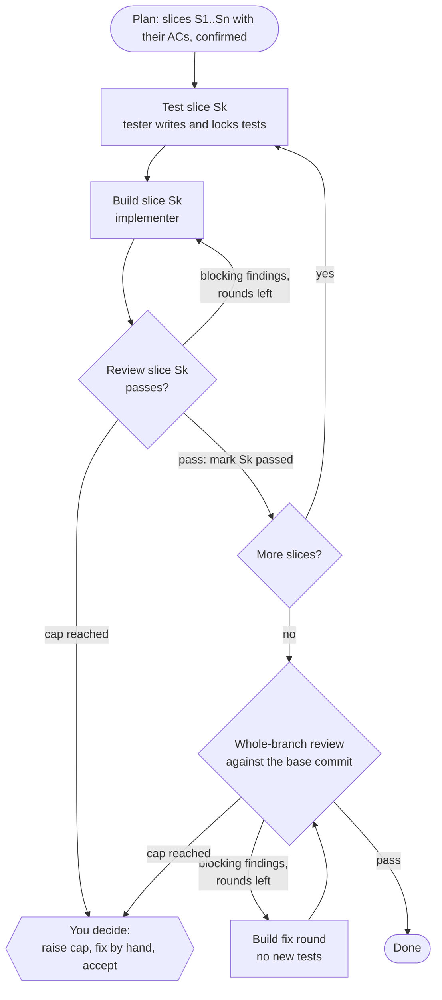
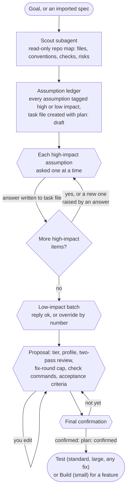
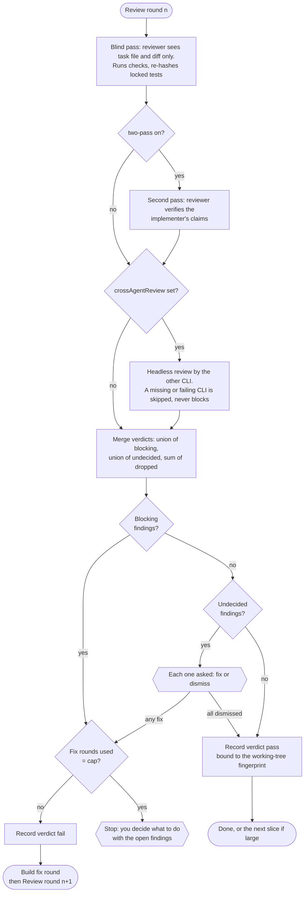

# Workflow in detail

The full flow behind `/loopwright-flow`. The [README](../README.md#how-it-works) has the short version. Each stage's `SKILL.md` in `content/skills/` is the authority; this page describes it.

Legend: rounded boxes are steps, diamonds are decisions, hexagons are points where loopwright stops and waits for you. "Main thread" means your session; subagents run in their own isolated context.

## Large tier: slices

Plan splits a large task into ordered slices. Each slice runs Test, Build and Review. When the last slice passes, one review covers the whole branch.

## Fixing a bug

`/loopwright-fix` runs the same stages with `kind: fix` in the task file. The differences:

- **Plan**: the scout reads your bug report, log or issue first. You are asked once for missing evidence (error text, steps, expected behavior) and confirm a root-cause hypothesis.
- **Test never skips**, at any tier. The tester writes a `[repro]` test for the correct behavior and locks it only after it fails for the reported reason, not for an unrelated one. A `[regression]` test covers behavior that must keep working and passes already.
- **No repro stops the task.** If the tester cannot reproduce the bug, you choose: add evidence, say which unit is at fault (a new `[repro]` criterion is recorded), or stop. There is no option to continue without a locked repro test; stopping marks the task `stopped`.
- **Build** names the root cause first and fixes it; suppressing the symptom (catching the error, special-casing the input) is not a fix.
- **Review** checks that the fix addresses the root cause and lists sibling code with the same flaw. After a pass you decide whether to include the siblings. Yes goes back to Plan and Test for their repro tests; no records them under `## Follow-ups` in the task file.
- **Done** puts the root cause, the repro test failing before and passing after, and the follow-ups in the PR draft.

## Plan, step by step

Plan runs in your main thread. Nothing is built until you confirm.

## Review, step by step

Review is a separate context that judges the change. This thread only dispatches reviewers, merges their verdicts and records the result.

A verdict goes stale when the code changes afterwards, so Done re-checks the fingerprint and sends you back to Review if it differs.

## Where loopwright stops and waits for you

- Each high-impact question, the low-impact batch, the tier and settings proposal, and the final plan confirmation.
- Tester `Uncovered` or `Needs` items, and implementer `Deviations`.
- Each undecided review finding, and the fix-round cap being reached.
- New upstream commits found before Plan and Build (Build asks only when they touch the task's files or feature).
- Each `AGENTS.md` or docs change, and the commit message and PR draft.

It never answers a gate itself, never treats silence as approval, and never commits.

## What the hooks do along the way

- **Locked-test guard**: during Build, edit tools cannot touch locked test files.
- **Stop gate**: in Build and Review, the agent cannot finish its turn without a passing verdict that matches the current working tree, except while it waits for one of your decisions.
- **Context reinjection**: after context compaction, the task's goal, stage, decisions and next step are printed again, plus the kind and root cause line for a fix.

Details and limits: [Enforcement](enforcement.md).
